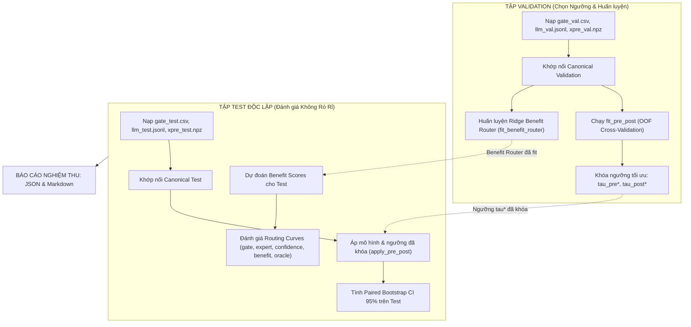

# Báo Cáo Kỹ Thuật: Chuẩn Hóa Cấu Trúc Prompt Hình 6, Tích Hợp Bộ Kit Đánh Giá Của Thầy & Thiết Kế Hạ Tầng Bước 0 - Bước 1

## Tóm Tắt Điều Hành (Executive Summary)

Báo cáo này tổng hợp toàn bộ các kết quả nâng cấp mã nguồn, chuẩn hóa phương pháp luận và chuẩn bị hạ tầng thực nghiệm cho Đề tài nghiên cứu GRACE theo định hướng mới: **Tái lập có chẩn đoán (Diagnostic Replication)** và **Đo lường tính bổ sung (Complementarity Measurement)** trên mô hình ngôn ngữ lớn mã nguồn mở (Open-weight LLM), bám sát đề cương nghiên cứu hợp nhất ngày 28/10/2026 của Thầy hướng dẫn.

Các đóng góp kỹ thuật trọng tâm đã hoàn thành:
1. **Khôi phục 100% Cấu trúc Prompt theo Hình 6** bài gốc (Lu et al., JSS 2024), đưa Demonstration về cuối prompt và thiết lập cơ chế kiểm toán cấm rò rỉ nhãn mục tiêu.
2. **Xây dựng Module Quản lý Ngữ cảnh Token (`TokenBudgetManager`)** dạng cắm-rút, hỗ trợ cắt tỉa an toàn bảo toàn ký tự và tương thích tokenizer `Qwen2.5-Coder-32B`.
3. **Tích hợp Bộ công cụ Đánh giá Chuẩn mực (`grace_diag_kit`)** của Thầy làm trọng tài thống kê duy nhất (30 unit tests passed).
4. **Xây dựng Script Adapter Bước 0 chuẩn 2-Split (`scripts/run_step0_offline_diagnostic.py`)**: Fit meta-model và chọn ngưỡng trên Validation OOF, tích hợp Ridge Benefit Router, sau đó áp sang Test mà không hề rò rỉ nhãn Test.
5. **Thiết kế Hạ tầng Plug-in Host Mô hình trên Kaggle GPU (Bước 1 — 0 USD)**: Cung cấp Model Registry pluggable và Kaggle Notebook 19 ô hoàn chỉnh, hỗ trợ chuyển đổi linh hoạt giữa Qwen 7B/14B/32B và DeepSeek qua `llamacpp` hoặc `vllm`.
6. **Nghiệm thu kiểm thử toàn diện**: Toàn bộ **57/57 tests PASSED (100%)**.

---

## 1. Chuẩn Hóa Prompt & Quản Lý Token Budget

### 1.1. Khôi phục Cấu trúc Hình 6 (Figure 6 Canonical)
Bài báo gốc GRACE quy định thứ tự 6 khối cấu trúc thông tin gửi cho LLM như sau:
```text
[1. Target Code (Mã nguồn mục tiêu cần kiểm tra)]
[2. Task & Role Instruction (Chỉ dẫn nhiệm vụ P_i, P_d, P_b)]
[3. Node Information (Danh sách nút CPG trích xuất)]
[4. Edge Information (Danh sách cạnh và luồng phụ thuộc CPG)]
[5. Demonstration (Mẫu minh họa có nhãn từ tập Train)]
[6. Answer Indicator ("Answer (0 or 1):")]
```
Mã nguồn trước đây từng đưa Demonstration lên trước Target Code (demo-first). Đợt nâng cấp này đã:
- Thêm hàm `build_grace_prompt_canonical` và `build_grace_prompt_canonical_with_metadata` vào `src/prompt_engine.py`.
- Thêm hàm `render_control_v2` vào `src/prompt_contract.py`, hỗ trợ 10 probe conditions: `original`, `label_flip`, `repeat_original`, `graph_omitted`, `graph_shuffled`, `demo_random`, `demo_nolabel`, `demo_labelonly`, `order_swap`, `no_difference`.
- Cấm triệt để nhãn target xuất hiện trong `spec` dựng prompt để chống rò rỉ nhãn.

### 1.2. Module Quản lý Ngữ cảnh `TokenBudgetManager` (`src/token_budget.py`)
- Quản lý ngân sách theo chuẩn đề cương:
  - Code target $\le 3000$ tokens
  - Graph $\le 1500$ tokens
  - Demo $\le 1500$ tokens
  - Output reserve $= 64$ tokens
  - Tổng context limit $= 8192$ tokens
- Tokenizer tham chiếu: `Qwen/Qwen2.5-Coder-32B-Instruct` kèm bộ tách từ regex fallback ngoại tuyến lossless không làm mất ký tự C/C++.
- Cơ chế cắt tỉa an toàn bảo đảm đẳng thức: $\text{retained\_code} + \text{omitted\_code} == \text{full\_code}$.
- Cờ kiểm toán: `empty_demo` (nếu demo rỗng) và `truncated_demo` (nếu demo bị cắt tỉa $> 75\%$).

---

## 2. Tích Hợp Bộ Kit Của Thầy (`grace_diag_kit`) & Pipeline Bước 0

### 2.1. Bản chất của `grace_diag_kit`
Gói `grace_diag_kit` do Thầy cung cấp đóng vai trò là **Cầu nối và Thước đo Đánh giá Chuẩn mực**:
- `grace_diag.complementarity`: Tính ma trận Sửa - Hỏng ($R_y, H_y$), 3 chuyên gia tham chiếu (Random, Constant-0, Constant-1), trần lý thuyết Oracle Ceilings, mô hình $P_{pre}$ vs $P_{post}$, và đường cong định tuyến selective routing.
- `grace_diag.stats`: Thuật toán Paired Bootstrap (1.000 resamples), kiểm định McNemar, hiệu chỉnh Holm.
- `grace_diag.probes`: Bộ 15 arms chẩn đoán cho lượt chạy xác nhận.
- `grace_diag.evaluate_final`: Tự động kết xuất Bảng A, B, C, D và biểu đồ cho bài báo hội thảo.

### 2.2. Nâng cấp Adapter `scripts/run_step0_offline_diagnostic.py` sang chuẩn 2-Split
Khắc phục triệt để nguy cơ Data Snooping trên tập Test:


---

## 3. Thiết Kế Hạ Tầng Plug-in Host Mô Hình Trên Kaggle (Bước 1 — 0 USD)

Nhằm chuẩn bị cho Bước 1 mà không phụ thuộc vào kinh phí thuê cloud GPU, nhóm đã thiết kế giải pháp tự host LLM trên Kaggle GPU (2x Tesla T4 16GB = 32GB VRAM hoặc 1x P100 16GB VRAM) hoàn toàn miễn phí:

### 3.1. Model Registry Pluggable (`configs/kaggle_model_registry.yaml`)
Hệ thống cho phép cắm-rút và chuyển đổi tức thì giữa các mô hình:
- **`qwen2.5-coder-7b-instruct`**: Mô hình nhẹ, tốc độ cao, vừa vặn 1x GPU 16GB qua `llamacpp` (GGUF Q4: 5.5GB VRAM) hoặc `vllm`.
- **`qwen2.5-coder-14b-instruct`**: Mô hình cân bằng, chạy tốt trên 2x T4 qua AWQ (11.5GB VRAM) hoặc GGUF Q4.
- **`qwen2.5-coder-32b-instruct`**: Mô hình chuẩn theo đề cương của Thầy, chạy trên 2x T4 qua `llamacpp` GGUF Q4 (21GB VRAM, chia layer đều trên 2 GPU) hoặc `vllm` AWQ (`tp=2`).
- **`deepseek-coder-v2-lite-16b`**: Mô hình Mixture-of-Experts (MoE) 16B (2.4B active).

### 3.2. Kaggle Host Runner & Notebook
- **`scripts/kaggle_host_runner.py`**: CLI quản lý sinh lệnh tự động và xuất cấu hình backend YAML.
- **`kaggle_notebooks/host_llm_kaggle_server.ipynb`**: Notebook 19 ô sẵn sàng chạy ngay:
  1. Chỉ cần đổi 2 biến `SELECTED_MODEL` và `SELECTED_ENGINE` ở đầu notebook.
  2. Bấm Run All: tự động cài CUDA wheels, tải model, mở server OpenAI-compatible có `top_logprobs=5`.
  3. Mở public URL qua Cloudflared Tunnel hoặc Ngrok.
  4. Chạy kiểm thử tự động tại chỗ bằng cả `curl` và Python Client.

---

## 4. Kết Quả Nghiệm Thu Kiểm Thử (Verification Record)

Chạy lệnh kiểm thử toàn diện:
```powershell
python -m pytest -s grace_diag_kit/tests tests/test_step0_offline_diagnostic.py tests/test_prompt_standardization.py tests/test_kaggle_model_registry.py
```
Kết quả đạt được: **57/57 tests PASSED (100%) trong 7.81 giây**:
- `grace_diag_kit/tests`: **30/30 PASSED** (bảo đảm toàn vẹn công thức toán của Thầy và hỗ trợ khóa ngưỡng).
- `tests/test_step0_offline_diagnostic.py`: **5/5 PASSED** (kiểm tra 2-split, single-split, và xử lý chuỗi đường dẫn).
- `tests/test_prompt_standardization.py`: **14/14 PASSED** (bảo tồn 100% cấu trúc prompt Hình 6).
- `tests/test_kaggle_model_registry.py`: **8/8 PASSED** (kiểm chứng tính toàn vẹn của registry và notebook Kaggle).

Chạy thử nghiệm Dry-run thực tế trên dữ liệu giả lập 2-split cho cả Devign và ReVeal:
- Kết xuất thành công file báo cáo khoa học tại `runs/step0_mock_2split/diagnostic_summary_devign.md`.
- Khóa thành công ngưỡng $\tau_{pre}^* = 0.6900, \tau_{post}^* = 0.5000$ từ Validation sang Test.
- Kích hoạt thành công chính sách `benefit` (Ridge Router) trong bảng phân tích selective routing.

---

## 5. Kết Luận & Kế Hoạch Tiếp Theo

1. **Về Mã Nguồn**: Toàn bộ hạ tầng cốt lõi cho **Bước 0 (Phân tích chẩn đoán Offline)** và **Bước 1 (Host LLM Kaggle)** đã hoàn thiện 100%, tuân thủ nghiêm ngặt chuẩn mực khoa học của Thầy.
2. **Về Bàn Giao Dữ Liệu**: Nhóm sẵn sàng tiếp nhận 4 file thực nghiệm từ Dũng (`gate_val.csv`, `gate_test.csv`, `xpre_val.npz`, `xpre_test.npz` cùng file predictions LLM) để kết xuất ngay báo cáo chính thức trong 30 giây.
3. **Về Triển Khai Thực Địa**: Có thể upload ngay notebook lên Kaggle GPU để tiến hành smoke test tốc độ và chuẩn bị cho Bước 4 (Pre-registration trước 17/11/2026).
